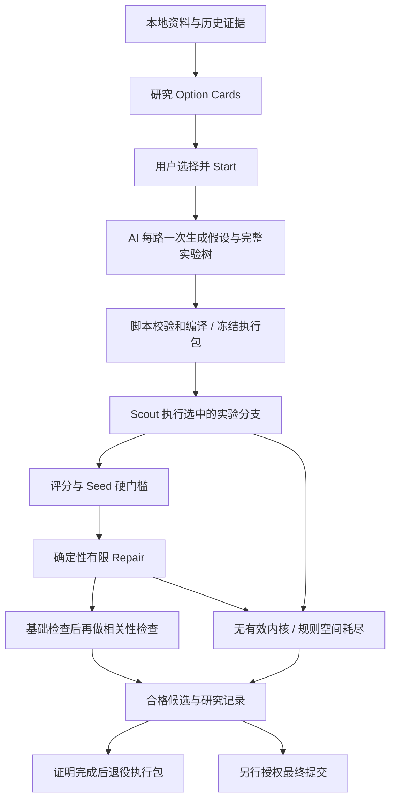

# BrainWorkflow

面向 WorldQuant BRAIN 的本地 Alpha 研究与经验积累系统。

**AI 负责前置研究设计；脚本负责确定性执行。用户选择方向并 Start / Stop，最终 Alpha 提交另行授权。**

## 当前功能

- Windows 桌面 Console：React / TypeScript 前端、Python 本地后端、pywebview / WebView2 宿主，使用 PyInstaller 构建 EXE。已有安装可点击启动，不要求用 CLI 操作日常研究。
- 研究排程：结合本地平台规则、活动、数据和历史证据生成 Option Cards，由用户选择研究目标。
- 预规划实验：AI 从字段含义出发匹配或提出经济模板，生成结构化假设、数据特性引用和完整条件实验树；程序校验、编译与冻结。
- 多路研究：默认两路，各路独立实验与进度；并行数可配置，资源限制与每日预算仍共享。
- 自动执行：回测、结果分支、Seed 筛选、有限 Repair、检查、候选记录及正常阶段转换无需逐关点击。
- 持久化恢复：计划、提交身份、结果、Stop、限流和错误均有本地记录，应用或聊天重启不等于重新开始研究。
- 本地经验维护：原始资料与研究记录编译为机器资源和可读经验；资料抓取是独立维护任务，不混入研究 Start。
- 执行包生命周期：脚本封装运行所需科学输入，完成后生成必要摘要、无损必要历史和退役回执，收集已验证的可回收输入。

这不是保证产生合格 Alpha 的工具。离线回归验证执行合同，不证明平台可用、经济因果或策略的未来收益。

## 完整研究路径



图中的“研究记录”包含失败和证据不足的结果，并不意味着产生了合格候选。实际路由由冻结计划和持久化状态决定，不是依次强行跑完每个模块。

### 1. 假设与实验树

AI 读取本地字段、算符、模板和历史证据，描述经济机制、数据角色、预测方向、适用条件、竞争性解释及可证伪实验。事实、实测特性、假设和未知项分别保存；未知语义不编造成事实。

新 `knowledge_catalog_v1` 模式不使用经济语义白名单限制已收录资源，但身份、来源、scope、时效、语法、类型和签名检查仍独立存在。确定性结构化特征编译优先支持 Level / Change / Relative；不支持的构造明确拒绝，不让脚本猜公式。

默认预规划配置为两路、两层、每路四个初始假设。每节点预存表达式、假设、实验配置、可计算分支规则、比较目标及回退条件。脚本按结果执行选中的后继，两侧满足规则时可都继续；不是无条件遍历所有节点，也不把负 Sharpe 自动翻转为信号。子实验退化时按预设规则保留较优父内核。

### 2. Seed 与 Repair

Seed 先满足硬门槛再按评分排序：默认 `Sharpe > 1.25`、`Turnover < 0.40`，并验证基础结果、比较周期和冻结策略，每路最多保留八个。平台最终提交检查是另一层条件，Seed 通过不等于可提交。

Repair 由脚本执行：

```text
冻结的数据特性 + 当前失败指标
→ 已批准规则及合法编辑
→ 有限算符 / 参数 / 设置候选
→ 去重与预算分配
→ 单因素回测
→ 接受、回退或停止
```

例如高换手优先测试平滑 / Decay，集中度问题测试权重限制。规则来源、合法类型、有限参数和接受条件都需要可追溯；不能更换核心字段或偷偷加入新的经济机制。新机制回到 Scout。

当前公开默认规则表主要覆盖 Decay 与 Truncation 的指标响应；更广的 transformation 或中性化搜索只有在对应资源和合法规则已配置时才能执行，**不是任意算符的通用优化器**。空间耗尽、没有合法新方案或触及限制时停止，并记录“当前规则空间未找到改善”，不声称经济机制已被否定。

### 3. 检查、记录与退役

先执行便宜的基础检查，符合条件后再做 SELF / PROD correlation，减少无意义请求。合格但未提交的 Alpha 保留身份、表达式 / 设置、指标与检查证据；只复用仍有效的证据，不把过期结果当通过。

脚本在冻结时生成自包含执行包。树、科学资源和脚本解析的特性随包固定；后续树 / Seed / Repair 不因全局知识库变化而漂移。Stop、共享预算、POST 对账、去重和检查有效性仍由各自模块动态管理。

只有树及派生 Seed / Repair 工作确实结束、记录已落盘且无待处理工作时才可退役。先生成并验证摘要与必要无损历史，再写退役回执，最后收集精确允许的输入。Pause、冷却、预算等待、未明 POST 或待检查工作不能触发退役；已退役历史只读，不授予 Resume 或最终提交权限。

## AI 与脚本的职责

| 模块 | 输入与输出 | 负责人 |
| --- | --- | --- |
| 排程与初始设计 | 本地资源、活动、历史 → 选项、结构化假设和实验树 | 排程规则与受限 AI；用户选择方向 |
| 校验与编译 | 假设、字段与算符 → 合法表达式和冻结计划 | Schema、AST、类型与来源校验脚本 |
| 执行与分支 | 冻结树、实际回测 → 后继节点和保留内核 | 确定性脚本 |
| Seed / Repair | 指标、特性、有限规则 → 排序与接受 / 回退轨迹 | 确定性脚本；无临时模型方案 |
| 记录与退役 | 结果、身份、检查、完成证明 → 可读历史与可回收输入 | 持久化脚本 |
| 知识与规则维护 | 新原始资料、研究经验 → 编译资源、经验与变更建议 | 单独启动的维护流程；规则修改经确认 |

AI 的输出不是执行权限。它不能增加额度、覆盖 Stop、伪造检查通过或授权最终提交。程序无法编译计划时记录具体原因，不绕过合同自行补公式。

## 可靠性与交互边界

- 日常操作：选 Option Card → **Start**；需要暂停 → **Stop**。左右切换和阶段 / 树节点点击是查看状态，不是推进关卡。关闭窗口不等于 Stop。
- 启动范围直接显示在界面并绑定命令修订。普通 Genius/Osmosis 目标可使用保存的精确 scope；尚未完成活动绑定、主题调查或比赛可行性确认的卡片标为需独立维护，不会被替换成普通研究。创建任务前的合同故障也会落盘、去重并异步通知维护；旧任务 Resume 不依赖新选项。
- 正常批次、轮询、限流冷却、在途对账和有界恢复由脚本处理；无法恢复的问题持久化并通过去重事件通知维护，不进行模型心跳轮询。
- Stop 优先于旧 Start、回调和重启；暂停后 Start 使用原有授权，不悄悄替换任务或扩大限制。
- 每日共享 **4,000 次 simulation 提交尝试**，按 Asia/Shanghai 日历重置。Multisimulation 按子策略扣费；GET 不扣本地 simulation 额度，失败或未知 POST 不退款。平台配额、时长和恢复次数限制独立。
- Scout / Discovery 批次最多三十个，不是最少三十个；使用有界 multisimulation，绝不为凑数填重复策略。
- 未知 POST 先对账，不盲重发；未完成检查不能进入合格候选。平台 429 不会因为本地预算尚有余额而被忽略。
- 平台在线资料更新、规则修改、代码维护、预算扩展和最终 Alpha 提交不由普通研究操作隐含授权。

## 模块与目录

```text
BrainWorkflow/
├─ wqb/          Python 后端、规划、编译、回测、恢复与生命周期
├─ frontend/     React / TypeScript / Vite 桌面前端
├─ tests/        离线合同、恢复、生命周期及集成测试
├─ configs/      公开默认规则与示例；本地配置忽略上传
├─ scripts/      构建、验证及维护脚本
├─ docs/         规格、计划、操作与维护文档
└─ launch-desktop.vbs / .cmd  产品点击入口
```

关键实现可按职责阅读：

- 规划：`preplanned_start.py`、`initial_research_planning.py`、`initial_model_worker.py`。
- 假设与编译：`hypothesis_design.py`、`hypothesis_template_compiler.py`、`semantic_contracts.py`、`template_binding.py`。
- 树与优化：`research_tree.py`、`tree_runtime.py`、`seed_policy.py`、`repair_search.py`、`configs/repair_rulebook.json`。
- 执行与恢复：`workflow_driver.py`、`runtime_control.py`、`daily_simulation_budget.py`。
- 执行包：`execution_package.py`、`execution_retirement.py`、`execution_package_lifecycle.py`。
- 应用：`console_api.py`、`desktop_application.py` 与 `frontend/`。

这些 Python 模块均位于 `wqb/`。Orchestrator 状态机、科学规则、资源准入和授权记账分离，局部更新不应顺带改变其他模块的权限。

## 使用与开发

已有本地部署：双击外层工作区的 `BrainWorkflow.vbs` / `.cmd`，或本目录的 `launch-desktop.vbs`。先选择方向再 Start；打开应用本身不启动研究。应用通过本地事件流及轮询同步状态，拒绝原因在界面内显示。

源码克隆**不包含**已安装 EXE、生产知识库、运行记录和个人配置，不能仅凭 Git clone 就声称真实研究可运行。首次部署需要按操作文档准备 Python 环境、编译资源、凭据及桌面构建；当前本地验收使用 Python 3.12。前端 Node / pnpm 约束与依赖版本见 `frontend/package.json` 和锁文件。

凭据仅通过环境变量 `WQB_USERNAME` / `WQB_PASSWORD` 等本地方式提供，禁止写进源码或提交。知识根可通过 `BRAIN_KNOWLEDGE_ROOT` 指定；实际 vault 与 `runs/` 放在仓库外的工作区。

从本目录运行后端离线测试：

```powershell
python -m unittest discover -s tests -q
```

前端开发检查（已准备依赖后，从 `frontend/` 运行）：

```powershell
pnpm typecheck
pnpm test
pnpm build
```

桌面构建入口为 `scripts/build_desktop.ps1`；构建不等于安装、激活或研究授权。维护验收还包括来源修订、离线回归、安装版本及 Console 动作 / 状态一致性检查。

## 仓库与本地资料边界

Git 保存代码、测试、公开规则、配置示例和设计 / 操作文档。**不上传实际知识库 raw/wiki/machine、私有研究记录、运行证据、凭据、本地配置、浏览器会话、依赖目录或构建产物。** 知识处理代码与公开示例仍是产品的一部分，不因知识库私有而移除。

知识维护有两条独立入口：研究后编译记录与经验；明确请求后更新平台资料并编译，再供研究使用。事实留在 raw，机器资源服务程序，可复用经验与案例供人阅读；日常 Start 不全库重编、不隐式抓取平台。

自包含树的自动退役已实现。通用桌面构建产物自动 GC 尚未实现；不能把一次性安全清理说成定期清理系统。历史兼容按冻结版本处理，已退役的旧模型 Repair 任务只读，不自动迁移或恢复。

## 继续阅读

- [用户操作指南](docs/operations/user_workflow_manual.md)：按钮、状态、研究运行与维护边界。
- [运维合同与命令参考](docs/operations/operating_guide.md)：诊断接口；历史说明以最新合同及本地部署记录为准。
- [维护交接指南](docs/operations/maintainer_handoff.md)：如何维护，不依赖超长聊天上下文。
- [执行包与退役设计](docs/superpowers/specs/2026-11-09-execution-package-retirement-design.md)。
- [最新存储清理与交付审计](docs/operations/storage-cleanup-2026-11-09.md)。

本地维护先读外层唯一的 `AGENTS.md`、`milestone.md`、`todo.md`，再按模块定位代码。Git 同步、文档更新或应用打开都不自动授权真实回测及最终提交。
