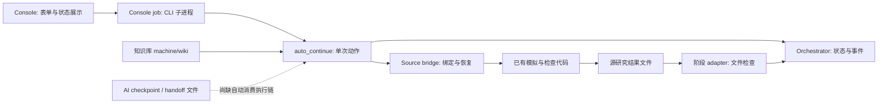

# BrainWorkflow 项目审查：自动运行与维护交互

日期：2026-09-05。审查对象为本地工作树，HEAD 为 `f8fa1fa`，包含尚未提交的维护修改。
这是审查结果与建议，不是已批准的新 spec，也不表示下面的改进已经实现。
本轮未运行平台 API、模拟或 Alpha 提交；只修改审查与交接文档。

## 判断

已有的记录、锁、来源追踪、知识资源和状态机可以复用。但目前的主流程仍偏向“有人反复调用的命令集合”，没有达到“选好目标后自动运行并恢复”的交付标准。换看板工具不能单独解决这个问题。

需要区分三种事实：代码存在、测试验证过、真实运行已经走通。当前多个交接记录把这些混在一起。

## 发现（按优先级）

### R1 / P1：自动继续只执行一个动作，没有持续驱动

- 位置：`wqb/workflow_auto_continue.py:157`、`:216`、`:225`、`:248`；`wqb/console_server.py:808`。
- 恢复已有模拟、重试计划队列、启动 source batch 后立即返回 `next_action=workflow-auto-continue`。Console 完成回调仅记录交接，没有调度下一个动作；前端轮询只刷新显示。
- 影响：用户必须再次点击；冷却到期并不自动唤醒。缺少持久化运行器，增加按钮不能实现无人推进。
- 建议：复用现有 Orchestrator，增加独立运行器；持续执行合法动作，将等待原因、唤醒时间、预算与停止请求持久化。Console 只是发命令和读状态，关闭浏览器不影响运行。
- 验收：只选择并启动一次，模拟平台返回等待、429、成功后仍自动完成后续步骤；进程重启后能从既有 progress URL 恢复，不重复提交。

### R2 / P1：Scout 到 Repair 的输入契约阻断了有信号但不达标的策略

- 位置：`wqb/source_bridge.py:446`、`:519`；`wqb/workflow_stage_adapters.py:185`；`wqb/cli.py:2467`。
- source bridge 依赖非空 `candidates.csv` 进入后续流程，而该文件在 hard-pass 时才写入。计划队列用尽、没有 hard-pass 时，返回 `source run exhausted without hard-pass candidates` 维护阻塞。
- 影响：已有 repairable signal 也无法自然进入主流程 Repair；普通研究失败被变成维护任务。此处不是要求放宽最终候选清单的标准。
- 建议：明确区分实验结果、可优化信号和可提交候选。Scout 产出研究结果与信号清单；Triage 自动决定 Seed、Repair、换模板/数据或预算用尽结束。仅最终候选保留全项检查通过的约束。
- 验收：一批 30 个全部未 hard-pass，其中两个可修复时，两个进入 Repair，其余被归档；全弱信号进入下一研究方向或正常结束，而不是 maintenance blocker。

### R3 / P1：阶段显示完成不代表执行过对应工作

- 位置：`wqb/workflow_stage_adapters.py:177`，由 `wqb/orchestrator.py:458` 调用。
- `batch_generation`、`backtest`、`repair` 都以同一个 `all_alphas.jsonl` 文件存在作为主要完成条件，没有对应执行器调用或阶段结果有效性验证。
- 本地复现：只创建空的 `all_alphas.jsonl`，调用 Repair adapter，即返回 `completed`；摘要中的 alpha_result_count 和 simulation_event_count 均为 0。
- 影响：导入历史结果后，时间线可以依次显示已回测、已优化，即使本轮没有完成这些行为。最终提交检查仍可能拦截，但阶段进度已不可信。
- 建议：阶段使用自身的输入/输出契约和执行记录。无需 Repair 时明确显示“无需优化”，不能由旧文件存在推断执行完成。
- 验收：空结果、旧版本结果、缺少本阶段证据都不能标记成功；明确无需处理的阶段可以带理由跳过。

### R4 / P1：Stop 没有停止后台 source 工作，而且等同于终止任务

- 位置：`wqb/console_jobs.py:441`；`wqb/orchestrator.py:234`；`wqb/workflow_auto_continue.py:218`。
- Console 的 Stop 映射到 `workflow-abort`，修改状态并清除 active pointer；没有向已经运行的 source 子进程传递停止请求。source runner 执行期间没有读取 Orchestrator 的取消状态。
- 影响：页面显示停止后，正在执行的 source 批次仍可能继续提交请求；原任务也不能通过普通继续恢复。此结论来自调用链审查，未用 live 模拟复现。
- 建议：用户按钮使用可恢复暂停；持久化 stop_requested，在下一次提交前检查并确认停止。已经提交的平台任务保留身份，恢复时只查询既有任务。永久终止放入高级管理。
- 验收：批次执行中停止，停止确认后没有新增提交；继续后不重复回测。

### R5 / P1：Console 与 CLI 的 readiness 来源不同

- 位置：`wqb/console_state.py:92`、`:482`；对照 `wqb/workflow_auto_continue.py:89`。
- CLI 优先读取绑定 source/active run 的报告；Console 仍扫描所有 runs，选择修改时间最新的报告，并以此决定普通 Continue 是否禁用。
- 本地复现：当前研究报告通过、无关研究报告失败且更新时，Console blocked=true，CLI blocker=null。反过来还可能显示可继续、实际执行又被拦截。
- 建议：UI 与运行器共用一个有 run_id、revision、证据时间的状态快照，禁止各层单独猜测优先级。
- 验收：插入任意无关研究报告都不能改变当前研究状态或按钮权限。

### R6 / P2：刷新重建整个操作表单，可能清掉用户刚勾选的授权

- 位置：`wqb/console_server.py:319`、`:485`、`:491`。
- 默认未勾选的 enable_live_api checkbox 被包含在每 3 秒以 innerHTML 替换的 workflow_progress 中；state_hash 虽记录但没有用于避免相同表单的重建。
- 影响：勾选后等待一次刷新再点 Continue，授权可能已经丢失，任务返回 enable-live-api-required。此项依据 DOM 替换逻辑，尚未做真实浏览器复现。
- 建议：启动时记录运行权限和预算；状态刷新只更新显示，不重建交互控件。必要的输入使用稳定 DOM 和受控状态。
- 验收：等待多轮刷新，选项不丢失；一次授权贯穿同一任务，不依赖重复勾选。

### R7 / P2：运行看板缺少逐策略的状态投影

- 位置：`wqb/console_jobs.py:258`；`wqb/console_state.py:455`；`wqb/console_timeline.py:101`。
- job progress 只为数据抓取计算进度；研究看板主要显示阶段与 job。没有从 planned candidates、simulation events、all_alphas 生成逐策略记录。
- `_finalize_process_result` (`console_jobs.py:170`) 以退出码 0 标记 job completed，即使业务结果是等待或阻塞；需要区分命令退出和研究结果。
- 建议：本地投影统一策略身份、模板族、父策略、当前步骤、模拟身份、结果指标、失败项、系统下一步、更新时间。按需展开细节，分页读取；不为刷新看板额外调用平台。
- 验收：同一 multi parent 下各 child 可分别展示；超时、429、检查等待、Repair、淘汰状态准确且不会虚构百分比。

### R8 / P2：AI checkpoint 与 handoff 是记录接口，尚未接上自动模型执行

- 位置：`wqb/ai_checkpoints.py:28`；`wqb/subagent_handoff.py:77`；`wqb/console_state.py:480`。
- 搜索当前 wqb/scripts，checkpoint 只有追加与读取接口；handoff 生成任务文件，没有发现自动消费、调用模型、校验结果再回写运行状态的完整执行链。
- 影响：不能将“存在 AI checkpoint”解释为“模型已经分析了模板/near-miss”。
- 建议：在模板假设、near-miss 解释、经验编译和规则提案处接入可替换的 AI worker；保存输入摘要、证据引用、模型配置、任务状态、输出、实际调用成本（可用时）。普通查询、重试、阈值比较由代码处理。
- 模型输出经结构与领域校验后进入运行器；限额或不可用时持久等待并解释原因，不要求用户去聊天窗口搬运文件。规则变更继续走用户决策。

### R9 / P2：交接记录已经过大、过期，并有多份并行事实源

- 位置：根 `milestone.md:3`；`wqb/console_context.py:20`；`README.md:75`。
- 本轮读取前，根 milestone 432,691 bytes、todo 506,956 bytes；仓库根及 BrainWorkflow 内另有记录。根 milestone 首条仍说必须刷新数据，但 todo 后文已记录 90 天阈值修改和后续回测；README Current Phase 仍指向 7 月规划。
- Console 每完成 job 追加通用记录，默认下一命令只是 workflow-status，无法概括真实主线。
- 建议：一个短的当前状态页 + 一个任务看板 + 历史日志。milestone 保留当前目标、活动任务 ID、最后验证、阻塞和下一步；历史归档。维护任务从卡片读取相关 spec、代码、测试和验收条件，不通读半年聊天。
- 卡片分清 proposed / accepted / implementing / verifying / released，增加适用代码版本；当前架构说明只展示已实现部分，未来设计明确标注。

### R10 / P1：交付验证不足以证明真实工作流可用

- 位置：`wqb/delivery_verification.py:11`、`:23`；`tests/test_workflow_auto_continue.py:171`、`:202`、`:415`。
- delivery verification 只启动 unittest 和 compileall，且通过 `sys.platform='linux'` 改变 Windows 测试环境。不能据此证明真实 Windows Console 行为正常。
- 本轮原生命令最初因缺 SystemRoot/ windir 导致 WinError 10106；补齐子进程环境后，相关 38 项测试运行完成，3 项因 readiness 新路径接触旧 Mock fixture 报错。这是当前测试契约缺口，不是之前报告中的临时目录 ACL 错误。
- 建议：保持真实操作系统，修正环境/fixture；增加本地假平台服务驱动的浏览器验收，并覆盖持久化恢复。记录测试的是工作树还是某次发布版本。
- 关键交付验收：选项一次启动、30 个批次、429 等待后自动恢复、部分失败分流、near-miss 修复、暂停/重启、状态一致、浏览器刷新不丢输入、候选仍全检查通过。

## 当前架构与目标边界

建议保留 Scout → Seed → Discovery → Repair → Submit 研究含义，不重写已有效的量化核心。
用持续运行器把执行动作连接起来，让 UI 与它共享同一状态。逐策略投影、架构图和维护看板分别承担“现在跑到哪”“项目怎样组成”“下一步改什么”。

## 用户操作目标

普通操作只需：选择工作流 → 选一张研究方向卡 → 启动；随后可以暂停/继续。
预算、允许的 API 行为等放入可复用运行配置，启动前给出摘要。

内部检查保留，但不要逐个变成人类决策：

| 情况 | 系统动作 | 用户看到 |
| --- | --- | --- |
| 已提交、等待平台 | 按 Retry-After/有界轮询等待 | 已完成数量、等待对象、下次查询时间 |
| 普通限流/暂时网络问题 | 有预算上限的退避和受控恢复 | 正在自动恢复、下次尝试时间 |
| 策略指标未达标 | 自动分流 Repair、淘汰或换方向 | 原因及下一步 |
| 策略没有信号 | 按既定预算探索下一方向或正常结束 | 本批结论与已积累经验 |
| 本地派生资源需更新 | 已授权且适用时执行增量维护 | 正在更新必要知识 |
| 平台资料更新超出当前权限 | 进入明确的权限请求，避免通用 gate | 具体要获取什么、为什么需要用户 |
| 凭据失效/外部服务长期不可用 | 保留状态，必要时请求介入 | 可操作的原因，而不是内部错误码 |
| 需要增加预算或改变研究原则 | 提交具体选择 | 选项及影响 |
| 最终 Alpha 提交 | 保留此前约定的显式授权 | 合格候选和最终确认 |

反复点击“确认429恢复”不能证明平台已经恢复。建议改为启动配置中的自动恢复政策：到期尝试、次数/总预算边界、耗尽后说明外部阻塞；不盲目无限重试。

## 逐策略运行看板

主页面：方向与已用预算；阶段路径；逐策略表；当前问题与系统动作。
表格列建议：策略 ID、经济假设/模板、版本/父策略、阶段、状态、Sharpe/Fitness、未通过项、下一动作、更新时间。
状态区分 planned / submitted / running / checking / repair / qualified / discarded / waiting / error；检查未完成不能算 qualified。
详情按需展开表达式、数据来源、PnL、检查结果、优化前后对比、AI 推理摘要与引用证据。
维护日志和内部 gate 默认折叠；不要让每条 Alpha 都成为外部项目管理工单。

## 成熟工具选择

| 工具 | 适合用途 | 对本项目的判断 |
| --- | --- | --- |
| GitHub Projects | Issues/PR 对应表格、看板、路线图、自定义字段 | 首选维护看板，已有 GitHub 仓库，额外运维最少 |
| Plane | 项目、work items、cycles/modules、文档；支持自托管与 API | 希望独立或自托管管理时可选，但增加部署、备份与升级工作 |
| Structurizr DSL | 基于 C4 的系统、容器、组件与动态架构视图 | 架构较复杂时引入；它不是任务看板，先用仓库内简图也可 |

官方资料（本轮已核对）：

- [GitHub Projects](https://docs.github.com/en/issues/planning-and-tracking-with-projects/learning-about-projects/about-projects)
- [Plane self-hosting](https://developers.plane.so/self-hosting/overview)
- [Plane docs](https://docs.plane.so/)
- [Structurizr DSL](https://docs.structurizr.com/dsl)

建议组合：GitHub Projects 管维护；仓库中的版本化架构图解释依赖；现有 Console 专门显示真实研究运行。
Console 可提供“运行/项目维护”两个入口：维护页展示当前版本、模块图与任务链接。运行期间无需跳出去问 Codex；提出改进时才进入维护入口。
看板任务最少字段：问题、影响模块、验收标准、证据引用、状态、实现 PR、验证/发布版本。敏感原始研究资料保留本地。
架构图每个模块连到代码位置、接口文档和相关维护任务；不能用手动拖动节点代替真实依赖更新。

## 实施建议（尚未执行）

### 补充要求：软件入口与实时交互（2026-09-05）

这是在前述审查主线上追加的用户要求，不替换研究流程、维护看板或逐策略视图。

用户日常入口应为桌面/开始菜单中的 BrainWorkflow：双击打开独立窗口，自动启动或连接本地运行器。CLI 留给维护诊断，不出现在日常操作说明的必经步骤中。重复双击应聚焦现有窗口，不重复启动后台任务。

仓库当前文档仍要求 `launch-console`；`wqb/console_server.py:1037` 使用 `webbrowser.open`。没有因此证明已经具备完整的桌面软件生命周期管理。建议采用薄桌面壳复用现有 Python 后端，具体框架和安装包方式留到实施 spec 决定；桌面壳本身不会解决后端卡顿。

代码侧已确认的性能风险：

- `console_server.py:60` 状态缓存 TTL 为 3 秒，前端同样每 3 秒拉取一次，可能频繁重建完整状态。
- `console_state.py:465` 每次完整加载全量 data ledger 并汇总可选 scope 等知识统计；这些数据不需要与每条回测进度一起重复计算。
- `console_server.py:879` 获取缓存签名会扫描多类 run/job 文件；历史增长会扩大每次刷新成本。
- `console_server.py:485`、`:491` 替换 HTML 片段，包含操作表单；既增加界面重建，也可能丢失勾选或焦点。

以上是代码审查证据，尚未做性能剖析，不能把用户感受到的全部延迟归因于某一个原因。实施前记录状态接口耗时、文件读取规模和界面更新时间作为基线。

建议改为：

1. 后台持续运行器将变化写成有序事件，同时维护轻量状态视图；桌面窗口接收推送并只更新发生变化的策略行。
2. 全量数据账本、知识统计和历史归档在变更时更新缓存或索引，离开高频状态读取路径。策略表分页，历史按需加载。
3. 连接短暂断开时自动重连并补齐事件；重连失败才显示具体问题。保留轻量轮询降级，不用刷新整个页面，也不重新发起研究。
4. 按钮立即反馈“已接收”，后台持久化后显示执行状态；重复点击幂等。输入和焦点不被刷新重置。
5. 窗口关闭默认不终止正在运行的研究，可收至托盘；暂停/退出由明确命令控制。系统重启后读取持久化状态，按运行配置恢复，不能丢失 progress URL。
6. 所有界面同步只访问本地状态，不增加 WorldQuant API 轮询频率；平台没有提供新进度时显示“等待平台”和最近更新时间，不虚构实时进展。

建议验收目标（待在真实机器上测量）：双击无命令行步骤；正常本地条件下操作在 200ms 内给出反馈，已落盘状态变化在 1 秒内显示；关闭再打开窗口不断研究、不重复模拟；连续刷新/推送不清除选择；大量历史记录不使当前策略表重复读取整份数据账本。

### 综合实施顺序

1. 先修 R2/R3/R4/R5 和现有测试失败，建立真实阶段结果、停止语义和统一状态来源。
2. 再补持续运行器：自动推进、冷却唤醒、预算、恢复、AI 任务消费；消除重复 gate 点击。
3. 在同一状态模型上做逐策略看板和完整浏览器验收，保留用户喜欢的主要布局。
4. 收敛当前文档、建立维护看板与架构视图；以后每项维护对应独立任务、验收和可追溯发布。

暂不建议同时迁移 Web 框架、引入大型分布式工作流平台、重写量化逻辑。先让现有模块兑现它们对用户的承诺。

## 本轮验证范围

- 代码与现有测试审查，两个本地临时 fixture 复现（空 Repair 结果和跨 run readiness 冲突）。临时文件已随测试清理。
- 设置当前子进程 `SystemRoot=C:\Windows`、`windir=C:\Windows` 后执行：
  `python -m unittest tests.test_workflow_auto_continue tests.test_console_timeline tests.test_workflow_stage_adapters -q`
- 结果：38 tests，3 errors，35 passed。未运行全套、浏览器实测或 live E2E，不宣称项目已可交付。
- 上轮 429 优化的局部代码/测试仍在工作树；本次不覆盖或宣称该维护已验收。
