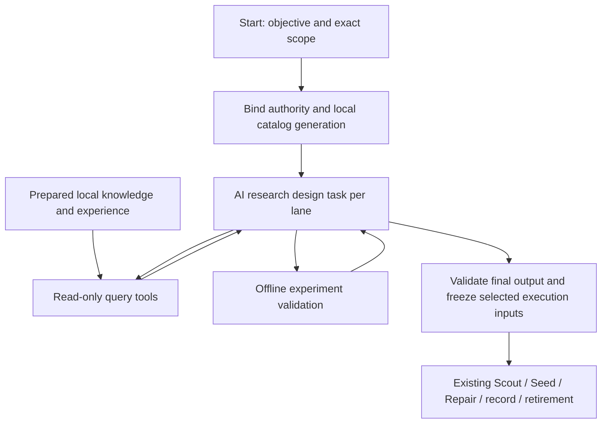

# Retrieval-Led Research Design

Status: approved 2026-11-24 for full implementation, followed by three new real
trees in ALL / Delay 1 / LARGE after offline/deployment acceptance. N=2, depth=2;
existing limits, Stop and separate final Alpha submission approval remain.
Replaces neither the Orchestrator nor execution rules.

## Product Contract

The operator selects a research objective and presses Start or Stop. Before
freezing, one logical design task per lane can retrieve local knowledge, compare
economic explanations, select resources and locally validate experiments. After
freezing, existing deterministic Scout, Seed and Repair execute without late AI
plans. Existing N-lane configuration remains; this is not one new coordinator agent
plus several new agent roles. Final Alpha submission stays separately authorized.

## Orthogonal Module Map

| Owner | Input -> output | Change |
| --- | --- | --- |
| Knowledge maintenance | captured raw and research records -> indexed resources, reusable evidence and wiki | prepare query-ready resources incrementally; not repeated full Start compilation |
| Query adapter | exact scope, catalog generation and bounded query -> compact rows or source excerpt with identity | expose field/operator/template/experience/source queries through existing local Python/JSON tooling; no separate service framework |
| Initial design worker | objective, limits, tools and output contract -> complete trees and data-characteristic references | AI selects material instead of receiving a tiny fixed field shortlist as its whole choice space |
| Technical compiler | proposed designs and selected sourced resources -> expressions, diagnostics and final validation | reuse AST/types/signatures and deterministic compiler; allow side-effect-free validation before final output |
| Start/package composer | validated design and selected resource references -> frozen run-local execution package | scripts resolve and seal selected inputs; AI never writes packages or grants authority |
| Runtime | frozen package and measured results -> branches, Seeds, Repair, durable records | unchanged, including Stop, budget, POST recovery, check validity and retirement |

## Local Query Contract

Provide five bounded query operations: fields, operators, templates, experience,
and source detail. Each response carries stable identities, actual scope/date,
resource generation and provenance references. Separate documented facts, measured
characteristics, economic hypotheses and unknowns. Unknown meaning alone is not
an admission failure. Search ranking is not a whitelist: allow pagination and exact
identity lookup. Never represent sampled absence as full-catalog absence.

Fields return meaning/raw description, type, available characteristics and usage
summaries. Operators return description and known technical signature/capability;
missing signatures remain explicit. Templates return economic mechanism, applicable
data roles, conditions and compatible compiler requirements. Experience returns
relevant successful, failed and inconclusive experiments with metrics, settings and
evidence references, not purported causal proof. Source detail is fetched on demand.

Reuse the rebuildable SQLite/index approach. Raw remains factual authority; do not
create another complete scientific vault or store a second raw copy in SQL. Query
indexes must not silently scan the full JSONL ledger on each request. A missing or
invalid index is an explicit preparation issue, with bounded local rebuilding from
existing raw where authorized; never an implicit full semantic/model compile.

Read-only queries cannot capture platform data, publish templates, simulate,
submit, change budgets or mutate research authority. Existing approved manual
Multiplier scope acquisition remains a separate, visible preparation branch when
needed. This design does not grant additional capture or model budget.

## AI Design Contract

Begin with a compact objective/scope/constraints brief and discoverable tool
contracts, not a full raw corpus or a mandatory 30-field shortlist. Retrieve enough
alternatives to compare mechanisms; inspect matching templates and historical
evidence, or record that relevant evidence was not found. Propose new templates
where matching ones are unsuitable, under existing draft/review/publication rules.

Each design explains mechanism, field roles, direction, applicable conditions,
competing explanations and falsifiable comparisons. Preserve the approved complete
experiment-tree structure, branching rules, comparisons and rollback behavior.
Data traits cite known characteristic keys; unknown traits stay unknown. Repair
resource suggestions reference the frozen rulebook and do not invent factual values
or override deterministic metric-to-action mappings.

The offline validator returns structured, located errors without running a
simulation, publishing a template or changing a run. The worker may correct a
draft inside the same bounded design task. One task may use multiple local tools;
this does not grant unlimited model invocations, retries or recovery budgets.
Preserve successful checkpoints and uncertain outcomes; do not blindly replay a
model task after interruption. A validated draft is not permission to execute it.

## Performance And Consistency

Bind queries to an identifiable catalog generation. Final selected references must
resolve to the same evidence used in the design; publication changes cannot silently
substitute new material. Scripts freeze only necessary selected inputs and original
identities. Global scientific-vault reads remain outside execution after sealing.

Keep source text once per selected material and use references between layers;
avoid repeated full raw copies in resource/evidence/brief objects. Record retrieved
rows, response bytes, source bytes, elapsed time, validation attempts and available
model usage separately. Do not infer tokens from disk bytes. Bounds belong in
existing configuration and must be explicit; numerical limits require the plan's
review, not hardcoded policy invented by this design document.

## Compatibility And Known Independent Gaps

Use a versioned new-start path. Old frozen runs keep their authority and formats;
no silent conversion. Reuse preplanned_start, initial_research_planning,
initial_model_worker, research_resource_catalog, source indexes, compiler, Repair
rulebook and execution-package lifecycle. Do not extend the core state machine.

The current feature DSL requires MATRIX starting inputs and many catalog operators
lack typed declarations. Retrieval alone does not solve these technical limits.
Never coerce VECTOR/GROUP implicitly or fabricate signatures. During implementation
inventory actual support and expose exact unsupported operations; any added typed
reduction/feature support needs its own scoped compiler design and tests. Do not
claim query access means every field/operator combination is compilable.

## Acceptance

### Nov24 Priority Alignment

The human prioritizes executable compiler/resource/startup integration and repeated
end-to-end experiments over further knowledge-base organization. Do not wait for
additional human documentation of empirical edge cases: preserve unknowns and,
where scientifically relevant, express them as bounded preplanned experiments.
This never permits guessed signatures, implicit vector reductions or fabricated
facts. Retain existing raw research/results/identity recording; defer new wiki
feedback taxonomy and automatic learning-rule design until actual traces exist.

Proposed first operational acceptance: three real experiment trees, preserving N=2
and depth=2, after offline tests and verified app deployment. Live scope must follow
the user's selected objective; existing budgets/Stop remain authoritative. A weak
tree can complete without Seed/Repair/candidate and must be reported honestly.
Exercise those stages offline even when live signals do not reach their thresholds.
Do not promise any fixed number of experiments will produce a qualified Alpha.
End-to-end live acceptance reaches qualified unsubmitted candidate evidence; actual
Alpha submission requires separate explicit approval of the concrete Alpha ID.
The human confirmed this three-tree scope on Nov24. No previously blocked or
retired mission is implicitly resumed. Three trees means two concurrent lanes
then one further tree, not three overlapping groups or three copies of one plan.

1. An offline fixture lets the worker discover a field outside the old shortlist,
   retrieve matching/contradictory evidence and produce a valid complete tree.
2. Query results preserve exact source/type/scope/date and unknown annotations;
   traces show indexed selection rather than repeated full-ledger traversal.
3. Invalid drafts receive local diagnostics and can be corrected before final
   freeze; unsupported operations reject without formulas guessed by scripts.
4. Once sealed, a complete offline research loop succeeds without global scientific
   knowledge reads and retains existing branching/Seed/Repair behavior.
5. Stop, interrupted design, stale generation, POST recovery, shared accounting,
   deduplication, candidate checks and final-submit authorization regressions pass.
6. Console shows design/retrieval/validation progress and precise blockers without
   adding routine stage-advance buttons. Deployment evidence must distinguish source,
   bundled application and actual loaded revision.

Next: implementation plan and offline-first development, verified deployment,
then the explicitly authorized three-tree operational trial. Existing authority
checks remain; this approval never renews old mission proofs, widens limits,
authorizes final Alpha submission or grants unrelated platform capture.
